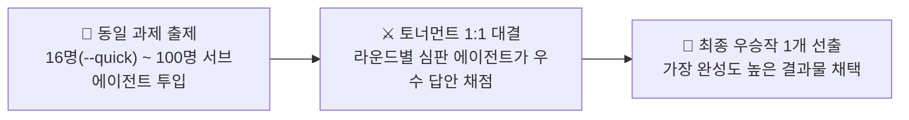

# Arena

> **[Claude Code / Antigravity 스킬 & 플러그인](../README.md)** · 세부 장르: `Claude Code 스킬` · 상태: `보고 싶음`

Claude가 자꾸 별로인 답을 줄 때, 같은 과제를 서브에이전트 100명에게 주고 토너먼트로 겨뤄 심판 채점으로 최종 답 1개를 남기는 Claude Code 스킬.

## 언제 꺼내 쓰나 (적재적소 활용 시점)

- 고난도 문제나 크리에이티브/설계 과제에서 단일 응답 품질이 아쉽고, 다수 에이전트 토너먼트 경쟁으로 최상위 품질의 답 1개를 뽑고 싶을 때

## 한눈에 보는 작동 흐름 (Visual Workflow)

- **실행 형태:** 🏆 토너먼트 경쟁 채택 스킬



| 구분 | 설명 |
| :--- | :--- |
| ❌ **기존 문제 (Before)** | 단일 프롬프트 응답이 평범하거나 마음에 들지 않아 여러 번 재질문 |
| ✅ **스킬 적용 후 (After)** | 수십 개 변형을 에이전트끼리 경쟁시켜 최고 품질의 답안 1개를 도출 |

## 단계별 명령어 & 프롬프트 치트시트

### ① 저장소 클론
- 스킬 다운로드
```text
powershell -File scripts\clone-skill.ps1 arena-skill
```

### ② 가성비 모드(--quick) 실행
- 100명 풀런(595회 호출) 대신 16명 토너먼트로 토큰 절약 추천
```text
/arena --quick [해결할 고난도 과제]
```

## 기본 정보

| 항목 | 내용 |
| :--- | :--- |
| **ID / 슬러그** | `#6` / `arena-skill` |
| **GitHub 저장소** | [Jakeschincariol/arena-skill](https://github.com/Jakeschincariol/arena-skill) |
| **빠른 링크** | [README](https://github.com/Jakeschincariol/arena-skill#readme) · [Issues](https://github.com/Jakeschincariol/arena-skill/issues) · [Releases](https://github.com/Jakeschincariol/arena-skill/releases) |
| **세부 장르** | Claude Code 스킬 |
| **저장 당시 스타** | ★ 1,452 |
| **주 언어 / 라이선스** | Python / MIT |
| **저장일 / 로컬 상태** | 2026-11-12 / 미클론 (경량 카드 모드) |
| **태그** | `#arena` `#claude-code` `#claude-skills` `#multi-agent` `#tournament` `#subagents` |

## 설치 및 활용 방법

- **가이드:** 저장소 클론 후 Claude Code 스킬 등록 (`--quick` 옵션으로 토큰 절약 가능)
- **원클릭 로컬 클론 (이 폴더 옆 `./repo`에 소스 다운로드):**
  ```powershell
  powershell -File ..\..\scripts\clone-skill.ps1 arena-skill
  ```
- **상태 변경:**
  ```powershell
  python ..\..\scripts\manage_skills.py status arena-skill "사용 중"
  ```

## 서재 메모 (Context & Caveats)

사용자 공유: 2026-10-04 릴로 소개, 2026-10-12 링크 요청, 2026-11-12 서재 추가 요청. 풀 100개 런은 595회 호출로 토큰을 많이 쓰므로 `--quick`(16개) 등 옵션 참고.

## 나의 실습 및 커스텀 노트 (User Notes)

- 여기에 직접 실행해본 설정값, 트러블슈팅, 커스텀 프롬프트 메모를 자유롭게 기록하세요.
