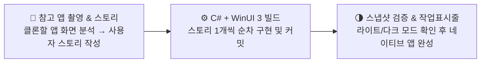

# BAWA (Build Any Windows App)

> **[Claude Code / Antigravity 스킬 & 플러그인](../README.md)** · 세부 장르: `Claude Code 플러그인 / 윈도우 앱 빌더` · 상태: `보고 싶음`

말로 시키면 C# + WinUI 3 네이티브 윈도우 앱을 만들어 작업 표시줄에 올려 주는 Claude Code 플러그인. BAMA의 윈도우용 형제 프로젝트. 스킬 22개가 마음에 드는 앱 화면 촬영(클론)→사용자 스토리→한 스토리씩 커밋하며 빌드, 커밋 전 라이트/다크 모드 스냅샷 확인.

## 언제 꺼내 쓰나 (적재적소 활용 시점)

- Windows 11 환경에서 웹앱이 아닌 C# + WinUI 3 네이티브 윈도우 데스크톱 앱을 단계별 스토리 검증과 스냅샷 확인을 거쳐 만들고 싶을 때

## 한눈에 보는 작동 흐름 (Visual Workflow)

- **실행 형태:** 🪟 Windows 네이티브 앱 빌더 플러그인 (22스킬)



| 구분 | 설명 |
| :--- | :--- |
| ❌ **기존 문제 (Before)** | 윈도우에서 웹 기반 래퍼가 아닌 진짜 WinUI 3 C# 앱을 짜기 번거로움 |
| ✅ **스킬 적용 후 (After)** | 말로 지시하면 스토리 단위로 스냅샷까지 검증하며 네이티브 윈도우 앱 완성 |

## 단계별 명령어 & 프롬프트 치트시트

### ① 저장소 클론
- Windows 11 + .NET/WinUI 3 환경 확인 후 클론
```text
powershell -File scripts\clone-skill.ps1 bawa
```

### ② 플러그인 활용
- 화면 클론→스토리→스냅샷 검증 사이클 실행
```text
BAWA 플러그인 워크플로우대로 [원하는 앱 설명]을 C# WinUI 3 앱으로 스토리별 빌드해줘
```

## 기본 정보

| 항목 | 내용 |
| :--- | :--- |
| **ID / 슬러그** | `#13` / `bawa` |
| **GitHub 저장소** | [daveebbelaar/bawa](https://github.com/daveebbelaar/bawa) |
| **빠른 링크** | [README](https://github.com/daveebbelaar/bawa#readme) · [Issues](https://github.com/daveebbelaar/bawa/issues) · [Releases](https://github.com/daveebbelaar/bawa/releases) |
| **세부 장르** | Claude Code 플러그인 / 윈도우 앱 빌더 |
| **저장 당시 스타** | ★ 14 |
| **주 언어 / 라이선스** | 미표기 / MIT |
| **저장일 / 로컬 상태** | 2026-11-07 / 미클론 (경량 카드 모드) |
| **태그** | `#BAWA` `#BAMA` `#Claude Code` `#윈도우 앱` `#WinUI 3` `#C#` |

## 설치 및 활용 방법

- **가이드:** 저장소 클론 후 README 가이드에 따라 Claude Code 플러그인 설치 (Windows 11 및 .NET/WinUI 3 SDK 필요)
- **원클릭 로컬 클론 (이 폴더 옆 `./repo`에 소스 다운로드):**
  ```powershell
  powershell -File ..\..\scripts\clone-skill.ps1 bawa
  ```
- **상태 변경:**
  ```powershell
  python ..\..\scripts\manage_skills.py status bawa "사용 중"
  ```

## 서재 메모 (Context & Caveats)

BAMA의 윈도우용 대안 — 주력 윈도우 머신에서 쓸 수 있어 BAMA보다 실용적. Windows 11 필요.

## 나의 실습 및 커스텀 노트 (User Notes)

- 여기에 직접 실행해본 설정값, 트러블슈팅, 커스텀 프롬프트 메모를 자유롭게 기록하세요.
