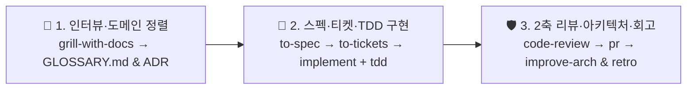

# Matt Pocock Skills (Skills For Real Engineers)

> **[Claude Code / Antigravity 스킬 & 플러그인](../README.md)** · 세부 장르: `Claude Code 스킬` · 상태: `사용 중`

TypeScript Wizard Matt Pocock의 실전 소프트웨어 엔지니어링 에이전트 스킬 27종 모음. 요구사항 압박 인터뷰(grill-with-docs), 도메인 용어집(GLOSSARY.md), 스펙/티켓 분해(to-spec/to-tickets), Red-Green-Refactor TDD, 2축 코드 리뷰(code-review), 깊은 모듈 아키텍처 개선(improve-codebase-architecture) 등을 제공.

## 언제 꺼내 쓰나 (적재적소 활용 시점)

- 바이브코딩으로 코드가 스파게티가 되는 것을 막고, 인터뷰→도메인 모델링→스펙/티켓→TDD→코드리뷰의 체계적인 엔지니어링 파이프라인으로 개발하고 싶을 때

## 한눈에 보는 작동 흐름 (Visual Workflow)

- **실행 형태:** ⚡ Antigravity 전역 플러그인 (27종 활성화)



| 구분 | 설명 |
| :--- | :--- |
| ❌ **기존 문제 (Before)** | 바이브코딩으로 의도와 다른 코드가 쌓이고 시간이 갈수록 수정 불가능한 스파게티화 |
| ✅ **스킬 적용 후 (After)** | 27개 엔지니어링 스킬이 요구사항 정렬·TDD·깊은 모듈 설계·2축 리뷰를 강제해 프로급 품질 유지 |

## 단계별 명령어 & 프롬프트 치트시트

### ① 프로젝트 최초 1회 세팅
- 이슈 트래커(GitHub/로컬 .scratch) 및 GLOSSARY.md 경로 초기 설정
```text
이 프로젝트에 setup-matt-pocock-skills 실행해줘
```

### ② 개발 시작 (인터뷰 + 용어집)
- 코딩 전 설계 빈틈을 메우고 공용어 정의
```text
이 기능 만들고 싶은데 grill-with-docs로 꼼꼼히 인터뷰하고 GLOSSARY.md 업데이트해줘
```

### ③ 스펙 → 티켓 → TDD 구현 → 리뷰
- 단일 티켓은 implement, 병렬 구현은 implement-spec 사용
```text
논의한 내용을 to-spec과 to-tickets로 쪼개고, implement-spec과 code-review까지 진행해줘
```

### ④ 전역 플러그인 최신 업데이트
- GitHub 최신 커밋을 가져와 Antigravity 전역 플러그인에 자동 반영
```text
.\01_claude-skills-plugins\mattpocock-skills\update-global-plugin.ps1
```

## 세부 스킬 / 파이프라인 단계 (27종)

| 이름 | 단계 | 작동 흐름 | 호출 명령 / 프롬프트 | 설명 |
| :--- | :---: | :--- | :--- | :--- |
| **setup-matt-pocock-skills** | `0. 초기 설정` | 레포 탐색 → 이슈 트래커·용어집 규칙 확정 → AGENTS.md/docs 설정 | `이 레포에 setup-matt-pocock-skills 실행해줘` | 프로젝트 최초 1회 실행. GitHub/로컬 이슈 트래커, 라벨, GLOSSARY.md/ADR 저장 경로를 자동 세팅. |
| **ask-matt** | `0. 라우터` | 현재 고민 입력 → 메인/온램프 흐름 분석 → 최적 스킬 경로 제안 | `ask-matt로 지금 상황에 맞는 스킬 워크플로우 추천해줘` | 27개 스킬 중 지금 어떤 스킬을 어떤 순서로 쓰면 될지 헷갈릴 때 길잡이 역할을 하는 라우터. |
| **grill-with-docs** | `1. 기획·도메인` | 아이디어 제시 → 집요한 꼬리질문 → GLOSSARY.md & ADR 자동 기록 | `이 기능 만들고 싶은데 grill-with-docs로 인터뷰해줘` | 코딩 전 설계 빈틈을 인터뷰로 메우고 프로젝트 공용어집(GLOSSARY.md)과 아키텍처 결정(ADR)을 남김. |
| **grill-me** | `1. 기획·도메인` | 기획/글 입력 → 결정 트리 전수 질문 → 모호함 0% 합의 | `이 계획/아이디어를 grill-me로 압박 인터뷰해줘` | 레포 파일(GLOSSARY 등)을 생성하지 않는 비코드/단순 아이디어 전용 무상태(stateless) 인터뷰. |
| **grilling** | `1. 기획·도메인` | 사용자 결정 추출 → 에이전트 사실 확인 → 미해결 분기 해소 | `(자동 호출) grilling 방식으로 요구사항을 구체화해줘` | grill-me, grill-with-docs, triage 등이 내부적으로 공유하는 핵심 인터뷰 엔진. |
| **domain-modeling** | `1. 기획·도메인` | 모호한 용어 탐지 → 경계 사례 검증 → GLOSSARY.md & ADR 갱신 | `domain-modeling으로 프로젝트 용어와 GLOSSARY.md를 다듬어줘` | 하나의 단어가 여러 뜻으로 쓰이는 혼란을 정리해 변수·함수명을 공용어로 통일. |
| **research** | `1. 기획·도메인` | 백그라운드 서브에이전트 조사 → 1차 문서 검증 → 인용 포함 .md 저장 | `research 스킬로 [주제]를 1차 출처 기준으로 조사해줘` | 공식 문서·코드를 백그라운드에서 조사하고 출처가 명시된 마크다운 보고서로 남김. |
| **prototype** | `1. 기획·도메인` | 설계 의문 제기 → 일회용 HTML/UI 시안 제작 → 검증 후 본 코드 반영 | `이 UI/상태 로직을 prototype으로 빠르게 검증해줘` | 본 구현 전에 상태 모델이나 3가지 UI 안을 단일 HTML/라우트로 띄워 눈으로 검증. |
| **wayfinder** | `1. 기획·도메인` | 거대한 불확실성 → 결정 티켓(Decision Map) 생성 → 순차 의사결정 | `wayfinder로 이 대형 프로젝트의 결정 지도를 그려줘` | 한 세션에 못 담을 대형/초기 프로젝트의 불확실성을 결정 티켓 지도로 쪼개서 해결. |
| **to-spec** | `2. 스펙·티켓` | 대화 맥락 종합 → 구조화 스펙 작성 → 이슈 트래커/문서 등록 | `방금 논의한 내용을 to-spec으로 스펙 문서로 정리해줘` | 인터뷰가 끝난 뒤 대화 내용을 구현 가능한 공식 스펙 문서로 변환. |
| **to-tickets** | `2. 스펙·티켓` | 스펙 분석 → 수직 슬라이스 분해 → Blocking 의존성 연결 | `이 스펙을 to-tickets로 의존성 있는 티켓들로 쪼개줘` | 스펙을 한 번에 구현 가능한 작은 tracer-bullet 티켓과 선후 의존 관계로 분할. |
| **triage** | `2. 스펙·티켓` | 외부 이슈 수집 → 원인 파악·라벨링 → 에이전트 실행 가능 티켓화 | `새로 들어온 버그/요청을 triage로 분류하고 정리해줘` | 외부에서 들어온 날것의 버그 리포트·요청을 구현 가능한 상태로 분류·정제. |
| **implement** | `3. 구현·TDD` | 티켓 읽기 → Red-Green-Refactor TDD 구현 → 2축 코드 리뷰 | `이 티켓/스펙을 implement로 TDD 기반 구현해줘` | 단일 티켓이나 중소 규모 기능을 TDD와 자동 코드 리뷰까지 묶어서 구현. |
| **implement-spec** | `3. 구현·TDD` | 의존성 그래프 분석 → 서브에이전트 병렬 TDD → 통합 브랜치 리뷰 | `implement-spec으로 티켓 그래프 전체를 병렬 구현해줘` | 의존성이 풀린 티켓들을 여러 서브에이전트가 동시에 병렬 구현한 뒤 통합 리뷰 수행. |
| **tdd** | `3. 구현·TDD` | 실패 테스트(Red) → 최소 구현(Green) → 리팩토링(Refactor) | `tdd 스킬을 적용해서 테스트 먼저 작성하고 구현해줘` | 구현과 테스트를 한 번에 몰아 쓰지 않고 수직 슬라이스 단위로 검증하며 개발. |
| **wizard** | `3. 구현·TDD` | 수동 작업 식별 → 대화형 Bash 위저드 생성 → .env/시크릿 자동 기록 | `이 수동 콘솔/시크릿 설정 과정을 wizard 스크립트로 만들어줘` | API 키 발급·대시보드 클릭 등 사람만 할 수 있는 절차를 대화형 셸 마법사로 자동화. |
| **diagnosing-bugs** | `4. 디버깅·설계` | 실패 재현 루프(Red) → 최소화·가설·계측 → 수정 & 회귀 테스트 | `이 버그를 diagnosing-bugs 루프로 원인부터 추적해줘` | 추측성 수정을 금지하고 먼저 '이 버그만 빨간불 뜨는 재현 커맨드'부터 확보해 근본 해결. |
| **improve-codebase-architecture** | `4. 디버깅·설계` | 코드베이스 스캔 → 모듈 심화(Deepening) 후보 발굴 → 시각 HTML 리포트 | `improve-codebase-architecture로 코드베이스 리팩토링 후보를 찾아줘` | 잘게 쪼개진 얕은 모듈들을 통합해 깊은 모듈로 개선할 수 있는 지점을 HTML 리포트로 제안. |
| **codebase-design** | `4. 디버깅·설계` | 경계(Seam) 탐색 → 작은 인터페이스 설계 → 테스트 가능성 검증 | `codebase-design 기준으로 이 모듈 인터페이스를 설계해줘` | Ousterhout의 깊은 모듈 철학(작은 인터페이스 + 큰 내부 구현)으로 모듈 구조를 설계. |
| **code-review** | `5. 리뷰·PR·회고` | 변경 Diff 추출 → 병렬 리뷰(코딩 표준 + 스펙 일치) → 결함 보고 | `현재 변경사항을 code-review로 Standards와 Spec 두 축으로 리뷰해줘` | 코딩 표준/코드 스멜 검사와 원 스펙 충실도 검사를 독립된 두 에이전트가 병렬 수행. |
| **pr** | `5. 리뷰·PR·회고` | 핵심 시각화 요약 → 전후 동작 증거 → 1-way/2-way 위험도 평가 | `pr 스킬 포맷으로 Pull Request 본문을 작성해줘` | 리뷰어가 한눈에 파악할 수 있는 최소 시각 자료와 머지 위험도를 포함한 PR 본문 작성. |
| **retro** | `5. 리뷰·PR·회고` | 세션 로그 회고 → 반복 실수 원인 진단 → AGENTS.md/린트/툴 개선 | `방금 세션을 retro로 회고하고 에이전트 환경 개선점을 제안해줘` | 작업 후 코드가 아닌 '에이전트 환경(규칙·테스트·네비게이션)'을 업그레이드해 재발 방지. |
| **handoff** | `6. 생산성·협업` | 현재 상태·결정·파일 요약 → 이식 가능한 Handoff .md 생성 → 새 세션 인계 | `현재 작업 맥락을 handoff 문서로 정리해줘` | 다른 디렉토리·다른 AI 에이전트·동료에게 작업 맥락을 손실 없이 넘길 때 사용. |
| **to-questionnaire** | `6. 생산성·협업` | 불명확한 결정 식별 → 수신자 맞춤 인터뷰 → 비동기 마크다운 질문지 생성 | `상대방에게 확인받을 내용을 to-questionnaire로 질문지로 만들어줘` | 기획자·클라이언트·동료의 결정이 필요할 때 빠짐없이 답을 받아낼 질문지를 생성. |
| **wait-what** | `6. 생산성·협업` | 이해 안 된 메시지 감지 → 빠진 전제 보충 → GLOSSARY 어휘로 평이하게 재설명 | `wait-what 방금 설명을 우리 용어집 기준으로 쉽게 다시 풀어서 설명해줘` | AI의 설명이 너무 어렵거나 맥락이 건너뛰어졌을 때 쉬운 말로 즉시 다시 풀어서 설명. |
| **teach** | `6. 생산성·협업` | 학습 목표 설정 → 미션·학습기록·자료 폴더 구성 → 실습 기반 다회차 학습 | `teach 스킬로 [주제]를 단계별 미션으로 가르쳐줘` | 현재 폴더를 상태 저장형 튜터링 공간으로 만들어 다회차 실습 학습을 진행. |
| **writing-for-agents** | `6. 생산성·협업` | 에이전트 문서 진단 → 점진적 공개(Progressive Disclosure) 적용 → 토큰 최적화 | `writing-for-agents 원칙으로 SKILL.md / AGENTS.md를 다듬어줘` | AI가 헷갈리지 않고 토큰을 낭비하지 않도록 스킬 문서와 AGENTS.md를 작성·리팩토링. |

## 기본 정보

| 항목 | 내용 |
| :--- | :--- |
| **ID / 슬러그** | `#44` / `mattpocock-skills` |
| **GitHub 저장소** | [mattpocock/skills](https://github.com/mattpocock/skills) |
| **빠른 링크** | [README](https://github.com/mattpocock/skills#readme) · [Issues](https://github.com/mattpocock/skills/issues) · [Releases](https://github.com/mattpocock/skills/releases) |
| **세부 장르** | Claude Code 스킬 |
| **저장 당시 스타** | ★ 330,084 |
| **주 언어 / 라이선스** | Shell / MIT |
| **저장일 / 로컬 상태** | 2026-11-22 / 로컬 클론 완료 (`./repo`) |
| **태그** | `#mattpocock` `#Claude Code` `#Antigravity` `#TDD` `#grill-me` `#도메인모델링` `#코드리뷰` `#아키텍처` |

## 설치 및 활용 방법

- **가이드:** 저장소 클론 후 README 참고 (`powershell -File scripts/clone-skill.ps1 mattpocock-skills`)
- **원클릭 로컬 클론 (이 폴더 옆 `./repo`에 소스 다운로드):**
  ```powershell
  powershell -File ..\..\scripts\clone-skill.ps1 mattpocock-skills
  ```
- **상태 변경:**
  ```powershell
  python ..\..\scripts\manage_skills.py status mattpocock-skills "사용 중"
  ```

## 서재 메모 (Context & Caveats)

Antigravity 전역 플러그인(~/.gemini/config/plugins/mattpocock-skills)으로 설치 완료 (27개 스킬 활성화).

## 나의 실습 및 커스텀 노트 (User Notes)

- 여기에 직접 실행해본 설정값, 트러블슈팅, 커스텀 프롬프트 메모를 자유롭게 기록하세요.
