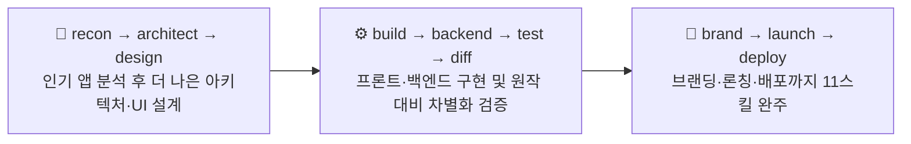

# Replica

> **[Claude Code / Antigravity 스킬 & 플러그인](../README.md)** · 세부 장르: `Claude Code 스킬` · 상태: `보고 싶음`

Claude 스킬 11종 묶음(`recon→architect→design→build→backend→test→diff→entrepreneur→brand→launch→deploy`). 인기 앱을 개선해 클론처럼 다시 만드는 흐름.

## 언제 꺼내 쓰나 (적재적소 활용 시점)

- 기존 인기 서비스의 강점을 정찰(recon)하고 설계·디자인·백엔드·테스트·브랜딩·배포까지 11단계 풀 파이프라인으로 개선된 신규 제품을 빌드하고 싶을 때

## 한눈에 보는 작동 흐름 (Visual Workflow)

- **실행 형태:** 🏗️ 11단계 풀스택 제품 클론·개선 파이프라인



| 구분 | 설명 |
| :--- | :--- |
| ❌ **기존 문제 (Before)** | 기존 앱을 참고해 만들다 중간에 방향을 잃고 디자인·백엔드·론칭이 따로 놂 |
| ✅ **스킬 적용 후 (After)** | 정찰부터 브랜딩·배포까지 11개 전용 스킬이 단계별로 빈틈없이 제품 완성 |

## 단계별 명령어 & 프롬프트 치트시트

### ① 저장소 클론
- 11종 파이프라인 스킬 다운로드 (스토어 심사 모방 주의)
```text
powershell -File scripts\clone-skill.ps1 replica-skill
```

### ② 11단계 파이프라인 시작
- 단계별 산출물을 검증하며 제품 빌드
```text
Replica 파이프라인(recon부터 시작)으로 [참고 서비스]의 불편한 점을 개선한 새 웹앱을 기획·구현해줘
```

## 세부 스킬 / 파이프라인 단계 (11종)

| 이름 | 단계 | 작동 흐름 | 호출 명령 / 프롬프트 | 설명 |
| :--- | :---: | :--- | :--- | :--- |
| **1. recon** | `분석` | 경쟁 앱 구조·기능·약점 정찰 | `/recon [참고 URL/서비스]` | 기존 인기 서비스의 핵심 기능과 사용자 불만 포인트 파악 |
| **2. architect** | `설계` | 기술 스택·데이터 모델·폴더 설계 | `/architect` | 확장 가능한 전체 시스템 아키텍처 정의 |
| **3. design** | `디자인` | 디자인 시스템·화면 와이어프레임 | `/design` | 차별화된 UI/UX 디자인 방향 수립 |
| **4. build** | `구현` | 프론트엔드 화면·인터랙션 구현 | `/build` | 디자인 기반 반응형 UI 컴포넌트 제작 |
| **5. backend** | `구현` | API·DB·인증 백엔드 연결 | `/backend` | 실제 동작하는 데이터 저장 및 서버 로직 구현 |
| **6. test** | `검증` | 핵심 시나리오 테스트 작성·통과 | `/test` | 버그 없이 동작하는지 자동 검증 |
| **7. diff** | `차별화` | 원본 대비 개선점·차별성 비교 | `/diff` | 단순 복제가 아닌 확실한 우위 요소 점검 |
| **8. entrepreneur** | `사업화` | 수익 모델·타겟·포지셔닝 정리 | `/entrepreneur` | 가격 정책 및 비즈니스 가치 구체화 |
| **9. brand** | `브랜딩` | 네이밍·카피라이팅·톤앤매너 | `/brand` | 독자적인 브랜드 정체성과 랜딩 카피 제작 |
| **10. launch** | `론칭` | 출시 체크리스트·홍보 자료 준비 | `/launch` | 프로덕트 런칭을 위한 안내/SEO 점검 |
| **11. deploy** | `배포` | 프로덕션 호스팅·도메인 연결 | `/deploy` | 실제 서비스 배포 완료 |

## 기본 정보

| 항목 | 내용 |
| :--- | :--- |
| **ID / 슬러그** | `#39` / `replica-skill` |
| **GitHub 저장소** | [Jakeschincariol/replica-skill](https://github.com/Jakeschincariol/replica-skill) |
| **빠른 링크** | [README](https://github.com/Jakeschincariol/replica-skill#readme) · [Issues](https://github.com/Jakeschincariol/replica-skill/issues) · [Releases](https://github.com/Jakeschincariol/replica-skill/releases) |
| **세부 장르** | Claude Code 스킬 |
| **저장 당시 스타** | ★ 2,800 |
| **주 언어 / 라이선스** | 미표기 / MIT |
| **저장일 / 로컬 상태** | 2026-11-06 / 미클론 (경량 카드 모드) |
| **태그** | `#Replica` `#Claude Code` `#스킬` `#클론 앱` |

## 설치 및 활용 방법

- **가이드:** 저장소 클론 후 Claude Code 플러그인으로 11종 스킬 설치
- **원클릭 로컬 클론 (이 폴더 옆 `./repo`에 소스 다운로드):**
  ```powershell
  powershell -File ..\..\scripts\clone-skill.ps1 replica-skill
  ```
- **상태 변경:**
  ```powershell
  python ..\..\scripts\manage_skills.py status replica-skill "사용 중"
  ```

## 서재 메모 (Context & Caveats)

사용자가 2026-10-09, 10-10, 10-16 세 차례 공유한 관심 프로젝트 — Claude Code 플러그인 설치, 원본 모방 시 앱스토어 심사 차단 주의.

## 나의 실습 및 커스텀 노트 (User Notes)

- 여기에 직접 실행해본 설정값, 트러블슈팅, 커스텀 프롬프트 메모를 자유롭게 기록하세요.
