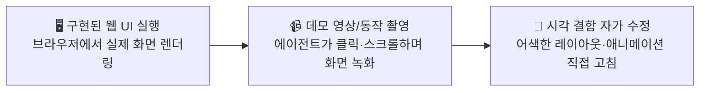

# Stageshow

> **[Claude Code / Antigravity 스킬 & 플러그인](../README.md)** · 세부 장르: `Claude Code 스킬` · 상태: `보고 싶음`

AI가 만든 제품 UI의 어설픔을 잡고, 완성된 데모를 영상으로 찍어 스스로 고치는 자기검증 스킬

## 언제 꺼내 쓰나 (적재적소 활용 시점)

- 프론트엔드 UI 구현 후 에이전트가 스스로 데모 영상을 녹화·검증해 시각적 어설픔과 인터랙션 결함을 자가 수정하게 만들고 싶을 때

## 한눈에 보는 작동 흐름 (Visual Workflow)

- **실행 형태:** 🎥 UI 자기검증 & 데모 수정 스킬



| 구분 | 설명 |
| :--- | :--- |
| ❌ **기존 문제 (Before)** | 에이전트가 코드만 짜고 실제 화면이 깨졌는지 확인을 안 함 |
| ✅ **스킬 적용 후 (After)** | 스스로 데모 영상을 찍어 눈으로 확인하고 어설픈 UI를 직접 수정 |

## 단계별 명령어 & 프롬프트 치트시트

### ① 저장소 클론
- X 디자인 총괄 Benji Taylor의 UI 스킬 세트 다운로드
```text
powershell -File scripts\clone-skill.ps1 stageshow
```

### ② 자기검증 요청
- 프론트엔드 완성도를 한 단계 끌어올릴 때 호출
```text
stageshow 스킬처럼 실제 화면 동작을 촬영·검증하면서 어색한 UI를 스스로 다듬어줘
```

## 기본 정보

| 항목 | 내용 |
| :--- | :--- |
| **ID / 슬러그** | `#11` / `stageshow` |
| **GitHub 저장소** | [benjitaylor/skills](https://github.com/benjitaylor/skills) |
| **빠른 링크** | [README](https://github.com/benjitaylor/skills#readme) · [Issues](https://github.com/benjitaylor/skills/issues) · [Releases](https://github.com/benjitaylor/skills/releases) |
| **세부 장르** | Claude Code 스킬 |
| **저장 당시 스타** | ★ 2,254 |
| **주 언어 / 라이선스** | 미표기 / MIT |
| **저장일 / 로컬 상태** | 2026-11-08 / 미클론 (경량 카드 모드) |
| **태그** | `#Claude Code` `#Codex` `#UI` `#디자인` `#데모` |

## 설치 및 활용 방법

- **가이드:** 저장소 클론 후 `benjitaylor/skills` README에 따라 Claude Code/Codex 스킬 설치
- **원클릭 로컬 클론 (이 폴더 옆 `./repo`에 소스 다운로드):**
  ```powershell
  powershell -File ..\..\scripts\clone-skill.ps1 stageshow
  ```
- **상태 변경:**
  ```powershell
  python ..\..\scripts\manage_skills.py status stageshow "사용 중"
  ```

## 서재 메모 (Context & Caveats)

사용자가 공유한 인스타 캐러셀(@prompt_what, 2026-11-07) — X 디자인 총괄 Benji Taylor의 무료 UI 스킬.

## 나의 실습 및 커스텀 노트 (User Notes)

- 여기에 직접 실행해본 설정값, 트러블슈팅, 커스텀 프롬프트 메모를 자유롭게 기록하세요.
