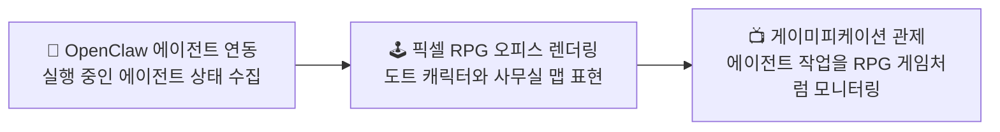

# agent-town

> **[AI 에이전트 · 멀티에이전트 · 시각화 · 인프라](../README.md)** · 세부 장르: `에이전트 시각화` · 상태: `보고 싶음`

이름이 정확히 AgentTown인 저장소. OpenClaw 기반 픽셀 RPG 오피스 형태로 에이전트 작업을 보여줌.

## 언제 꺼내 쓰나 (적재적소 활용 시점)

- OpenClaw 기반 픽셀 RPG 오피스 UI로 AI 에이전트들의 작업 현황을 시각적으로 즐기며 관제하고 싶을 때

## 한눈에 보는 작동 흐름 (Visual Workflow)

- **실행 형태:** 🎮 픽셀 RPG 오피스 에이전트 시각화



| 구분 | 설명 |
| :--- | :--- |
| ❌ **기존 문제 (Before)** | 딱딱한 검은 터미널 로그만 바라보며 작업 대기 |
| ✅ **스킬 적용 후 (After)** | 픽셀 RPG 오피스 캐릭터들이 움직이며 일하는 모습을 보며 재미있게 관제 |

## 단계별 명령어 & 프롬프트 치트시트

### ① 저장소 클론
- geezerrrr/agent-town 다운로드 (심시티형은 agentcity 참고)
```text
powershell -File scripts\clone-skill.ps1 agent-town
```

### ② 실행 확인
- 로컬 관제 대시보드 구동
```text
agent-town README에 따라 OpenClaw 기반 픽셀 오피스를 실행해줘
```

## 기본 정보

| 항목 | 내용 |
| :--- | :--- |
| **ID / 슬러그** | `#34` / `agent-town` |
| **GitHub 저장소** | [geezerrrr/agent-town](https://github.com/geezerrrr/agent-town) |
| **빠른 링크** | [README](https://github.com/geezerrrr/agent-town#readme) · [Issues](https://github.com/geezerrrr/agent-town/issues) · [Releases](https://github.com/geezerrrr/agent-town/releases) |
| **세부 장르** | 에이전트 시각화 |
| **저장 당시 스타** | ★ 259 |
| **주 언어 / 라이선스** | 미표기 / MIT |
| **저장일 / 로컬 상태** | 2026-11-06 / 미클론 (경량 카드 모드) |
| **태그** | `#agent-town` `#AgentTown` `#에이전트 시각화` `#픽셀 오피스` |

## 설치 및 활용 방법

- **가이드:** 저장소 클론 후 README 실행 방법 참고
- **원클릭 로컬 클론 (이 폴더 옆 `./repo`에 소스 다운로드):**
  ```powershell
  powershell -File ..\..\scripts\clone-skill.ps1 agent-town
  ```
- **상태 변경:**
  ```powershell
  python ..\..\scripts\manage_skills.py status agent-town "사용 중"
  ```

## 서재 메모 (Context & Caveats)

사용자가 2026-11-05 공유한 AI 에이전트 시각화 도구 글(@vibebusiness0928) — 심시티형 화면(`YehudaLevi/agentcity`)과는 기능이 다름.

## 나의 실습 및 커스텀 노트 (User Notes)

- 여기에 직접 실행해본 설정값, 트러블슈팅, 커스텀 프롬프트 메모를 자유롭게 기록하세요.
