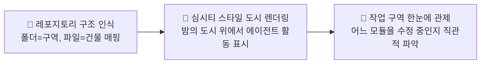

# agentcity

> **[AI 에이전트 · 멀티에이전트 · 시각화 · 인프라](../README.md)** · 세부 장르: `에이전트 시각화` · 상태: `보고 싶음`

심시티형 에이전트 시각화. 레포=건물·작업 종류=구역 콘셉트로, 파일→건물·폴더→구역으로 도시를 그려 에이전트 작업을 한눈에 보여줌.

## 언제 꺼내 쓰나 (적재적소 활용 시점)

- AI 에이전트가 탐색·수정하는 코드 저장소(폴더=구역, 파일=건물)를 밤의 심시티 도시 형태로 시각화해 모니터링하고 싶을 때

## 한눈에 보는 작동 흐름 (Visual Workflow)

- **실행 형태:** 🏙️ 심시티형 에이전트 작업 시각화



| 구분 | 설명 |
| :--- | :--- |
| ❌ **기존 문제 (Before)** | 에이전트가 어떤 폴더와 파일을 건드리는지 로그 텍스트로만 확인 |
| ✅ **스킬 적용 후 (After)** | 폴더를 구역으로, 파일을 건물로 그린 심시티 도시 위에서 실시간 관제 |

## 단계별 명령어 & 프롬프트 치트시트

### ① 저장소 클론
- YehudaLevi/agentcity 다운로드
```text
powershell -File scripts\clone-skill.ps1 agentcity
```

### ② 시각화 실행
- 대규모 프로젝트 작업 구역 시각화
```text
agentcity README에 따라 내 프로젝트 폴더를 도시 뷰로 띄워줘
```

## 기본 정보

| 항목 | 내용 |
| :--- | :--- |
| **ID / 슬러그** | `#30` / `agentcity` |
| **GitHub 저장소** | [YehudaLevi/agentcity](https://github.com/YehudaLevi/agentcity) |
| **빠른 링크** | [README](https://github.com/YehudaLevi/agentcity#readme) · [Issues](https://github.com/YehudaLevi/agentcity/issues) · [Releases](https://github.com/YehudaLevi/agentcity/releases) |
| **세부 장르** | 에이전트 시각화 |
| **저장 당시 스타** | ★ 1 |
| **주 언어 / 라이선스** | 미표기 / MIT |
| **저장일 / 로컬 상태** | 2026-11-06 / 미클론 (경량 카드 모드) |
| **태그** | `#agentcity` `#AgentTown` `#에이전트 시각화` `#심시티` |

## 설치 및 활용 방법

- **가이드:** 저장소 클론 후 README 실행 가이드 참고
- **원클릭 로컬 클론 (이 폴더 옆 `./repo`에 소스 다운로드):**
  ```powershell
  powershell -File ..\..\scripts\clone-skill.ps1 agentcity
  ```
- **상태 변경:**
  ```powershell
  python ..\..\scripts\manage_skills.py status agentcity "사용 중"
  ```

## 서재 메모 (Context & Caveats)

사용자가 2026-11-05 공유한 AI 에이전트 시각화 도구 글(@vibebusiness0928) 2번 화면과 가장 가까운 저장소. `geezerrrr/agent-town`과 구분 필요.

## 나의 실습 및 커스텀 노트 (User Notes)

- 여기에 직접 실행해본 설정값, 트러블슈팅, 커스텀 프롬프트 메모를 자유롭게 기록하세요.
