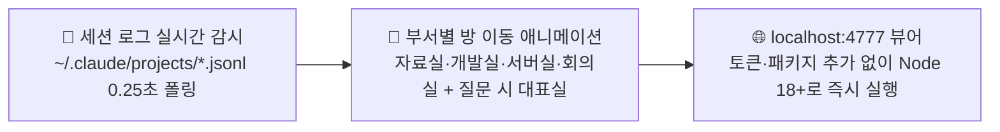

# claude-office

> **[AI 에이전트 · 멀티에이전트 · 시각화 · 인프라](../README.md)** · 세부 장르: `에이전트 시각화` · 상태: `보고 싶음`

Claude Code(+Codex) 작업을 브라우저 속 미니처 사무실 캐릭터로 보여주는 로컬 도구. `~/.claude/projects/*.jsonl`을 0.25초마다 읽어 방(자료실·개발실·서버실·정보검색실·회의실·휴게실)으로 캐릭터 이동, 질문 시 대표실로 엘리베이터.

## 언제 꺼내 쓰나 (적재적소 활용 시점)

- 추가 API 토큰 비용이나 복잡한 설치 없이 로컬 Claude Code / Codex 세션 로그를 실시간 한국형 미니어처 사무실 캐릭터(`localhost:4777`)로 모니터링하고 싶을 때

## 한눈에 보는 작동 흐름 (Visual Workflow)

- **실행 형태:** 🏢 한국형 미니어처 사무실 시각화 (localhost:4777)



| 구분 | 설명 |
| :--- | :--- |
| ❌ **기존 문제 (Before)** | 에이전트가 지금 파일을 읽는지, 서버를 돌리는지, 질문을 기다리는지 한눈에 안 보임 |
| ✅ **스킬 적용 후 (After)** | 자료실·개발실·대표실을 오가는 미니어처 캐릭터로 API 토큰 0원에 실시간 확인 |

## 단계별 명령어 & 프롬프트 치트시트

### ① 저장소 클론
- 한국 제작, 추가 npm 패키지·API 토큰 소모 없음
```text
powershell -File scripts\clone-skill.ps1 claude-office
```

### ② 뷰어 실행
- Claude Code & Codex 세션을 실시간 사무실 화면으로 관제
```text
node server.js   # 실행 후 브라우저 http://localhost:4777 접속
```

## 기본 정보

| 항목 | 내용 |
| :--- | :--- |
| **ID / 슬러그** | `#35` / `claude-office` |
| **GitHub 저장소** | [toplainsoft/claude-office](https://github.com/toplainsoft/claude-office) |
| **빠른 링크** | [README](https://github.com/toplainsoft/claude-office#readme) · [Issues](https://github.com/toplainsoft/claude-office/issues) · [Releases](https://github.com/toplainsoft/claude-office/releases) |
| **세부 장르** | 에이전트 시각화 |
| **저장 당시 스타** | ★ 23 |
| **주 언어 / 라이선스** | 미표기 / MIT |
| **저장일 / 로컬 상태** | 2026-11-06 / 미클론 (경량 카드 모드) |
| **태그** | `#claude-office` `#에이전트 시각화` `#Claude Code` `#Codex` |

## 설치 및 활용 방법

- **가이드:** Node.js 18+ 환경에서 저장소 클론 후 실행 → 브라우저 `localhost:4777` 접속
- **원클릭 로컬 클론 (이 폴더 옆 `./repo`에 소스 다운로드):**
  ```powershell
  powershell -File ..\..\scripts\clone-skill.ps1 claude-office
  ```
- **상태 변경:**
  ```powershell
  python ..\..\scripts\manage_skills.py status claude-office "사용 중"
  ```

## 서재 메모 (Context & Caveats)

사용자가 2026-10-22 공유한 관심 프로젝트 — `localhost:4777`, 토큰·패키지 설치 없음, Node.js 18+만 필요. Codex `~/.codex/sessions` 자동 인식. 한국 제작.

## 나의 실습 및 커스텀 노트 (User Notes)

- 여기에 직접 실행해본 설정값, 트러블슈팅, 커스텀 프롬프트 메모를 자유롭게 기록하세요.
