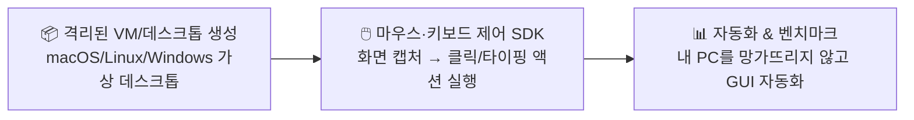

# cua

> **[AI 에이전트 · 멀티에이전트 · 시각화 · 인프라](../README.md)** · 세부 장르: `AI 에이전트 인프라` · 상태: `보고 싶음`

AI 에이전트에 쓸 컴퓨터를 주는 인프라. 크로스 OS 드라이버·클라우드 데스크톱 플릿·로컬 VM·벤치마크 모음.

## 언제 꺼내 쓰나 (적재적소 활용 시점)

- GUI 조작이 가능한 Computer-Use AI 에이전트를 격리된 로컬 VM이나 크로스 OS 데스크톱 환경에서 실행·벤치마크하고 싶을 때

## 한눈에 보는 작동 흐름 (Visual Workflow)

- **실행 형태:** 🖥️ Computer-Use 에이전트 VM 인프라



| 구분 | 설명 |
| :--- | :--- |
| ❌ **기존 문제 (Before)** | GUI 조작 AI 에이전트를 내 메인 PC에서 직접 돌리면 오작동 위험이 큼 |
| ✅ **스킬 적용 후 (After)** | 크로스 OS 드라이버와 격리된 로컬 VM 위에서 안전하게 Computer-Use 실행 |

## 단계별 명령어 & 프롬프트 치트시트

### ① 저장소 클론
- trycua/cua SDK 및 VM 드라이버 다운로드
```text
powershell -File scripts\clone-skill.ps1 cua
```

### ② 에이전트 샌드박스 구축
- Python 기반 Computer-Use 에이전트 연동
```text
cua SDK로 격리된 데스크톱 VM에서 GUI 에이전트를 돌리는 예제 코드를 작성해줘
```

## 기본 정보

| 항목 | 내용 |
| :--- | :--- |
| **ID / 슬러그** | `#23` / `cua` |
| **GitHub 저장소** | [trycua/cua](https://github.com/trycua/cua) |
| **빠른 링크** | [README](https://github.com/trycua/cua#readme) · [Issues](https://github.com/trycua/cua/issues) · [Releases](https://github.com/trycua/cua/releases) |
| **세부 장르** | AI 에이전트 인프라 |
| **저장 당시 스타** | 미표기 |
| **주 언어 / 라이선스** | 미표기 / MIT |
| **저장일 / 로컬 상태** | 2026-11-06 / 미클론 (경량 카드 모드) |
| **태그** | `#cua` `#컴퓨터 사용 에이전트` `#에이전트 인프라` |

## 설치 및 활용 방법

- **가이드:** 저장소 클론 후 README SDK/VM 설정 가이드 참고
- **원클릭 로컬 클론 (이 폴더 옆 `./repo`에 소스 다운로드):**
  ```powershell
  powershell -File ..\..\scripts\clone-skill.ps1 cua
  ```
- **상태 변경:**
  ```powershell
  python ..\..\scripts\manage_skills.py status cua "사용 중"
  ```

## 서재 메모 (Context & Caveats)

2026-10-25 @jisik.chanel '모르면 손해보는 오픈소스 9가지' 7번 — 단, Spaces 앱은 FSL-1.1-MIT 소스 공개형.

## 나의 실습 및 커스텀 노트 (User Notes)

- 여기에 직접 실행해본 설정값, 트러블슈팅, 커스텀 프롬프트 메모를 자유롭게 기록하세요.
