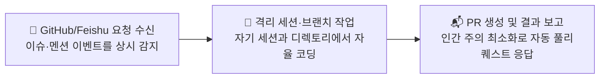

# Towards a More Autonomous Agent System

> **[AI 에이전트 · 멀티에이전트 · 시각화 · 인프라](../README.md)** · 세부 장르: `AI 에이전트 / 코딩 에이전트` · 상태: `보고 싶음`

DeepSeek Harness용 프로액티브 코딩 에이전트 연구 프로토타입. 하나의 GitHub 저장소를 대상으로 GitHub(선택: Feishu) 요청을 듣고 작업 항목을 열어 자기 세션·디렉토리에서 작업한 뒤 PR 등으로 응답. 공식 DeepSeek 제품이 아니라 참고용 연구 코드이며, 운영 철학은 '인간 주의는 최소로, 가치는 최대로'. `SETUP.md`를 코딩 에이전트와 함께 읽으며 설치.

## 언제 꺼내 쓰나 (적재적소 활용 시점)

- GitHub 이슈/요청을 스스로 감지해 격리 세션에서 작업하고 PR로 응답하는 프로액티브 자율 코딩 에이전트 아키텍처(`SETUP.md`)를 연구하거나 시험해보고 싶을 때

## 한눈에 보는 작동 흐름 (Visual Workflow)

- **실행 형태:** 🤖 프로액티브 자율 코딩 에이전트 (연구용)



| 구분 | 설명 |
| :--- | :--- |
| ❌ **기존 문제 (Before)** | 개발자가 매번 터미널을 열어 에이전트를 붙잡고 일일이 지시 |
| ✅ **스킬 적용 후 (After)** | GitHub 요청을 스스로 받아 작업 후 PR로 돌려주는 프로액티브 에이전트 구조 학습 |

## 단계별 명령어 & 프롬프트 치트시트

### ① 저장소 클론
- DeepSeek Harness 연구용 프로토타입 다운로드
```text
powershell -File scripts\clone-skill.ps1 dsh-superagent-prototype
```

### ② 코딩 에이전트와 함께 셋업
- 연구용 프로토타입이므로 프로덕션 직접 투입 전 검증 필수
```text
이 저장소의 SETUP.md를 읽고 프로액티브 에이전트 아키텍처와 동작 원리를 단계별로 설명해줘
```

## 기본 정보

| 항목 | 내용 |
| :--- | :--- |
| **ID / 슬러그** | `#43` / `dsh-superagent-prototype` |
| **GitHub 저장소** | [deepseek-ai/dsh-superagent-prototype](https://github.com/deepseek-ai/dsh-superagent-prototype) |
| **빠른 링크** | [README](https://github.com/deepseek-ai/dsh-superagent-prototype#readme) · [Issues](https://github.com/deepseek-ai/dsh-superagent-prototype/issues) · [Releases](https://github.com/deepseek-ai/dsh-superagent-prototype/releases) |
| **세부 장르** | AI 에이전트 / 코딩 에이전트 |
| **저장 당시 스타** | 미표기 |
| **주 언어 / 라이선스** | 미표기 / MIT |
| **저장일 / 로컬 상태** | 2026-11-06 / 미클론 (경량 카드 모드) |
| **태그** | `#dsh-superagent-prototype` `#DeepSeek` `#Harness` `#코딩 에이전트` `#프로액티브 에이전트` `#Feishu` |

## 설치 및 활용 방법

- **가이드:** 저장소 클론 후 `SETUP.md`를 코딩 에이전트와 함께 읽으며 설정
- **원클릭 로컬 클론 (이 폴더 옆 `./repo`에 소스 다운로드):**
  ```powershell
  powershell -File ..\..\scripts\clone-skill.ps1 dsh-superagent-prototype
  ```
- **상태 변경:**
  ```powershell
  python ..\..\scripts\manage_skills.py status dsh-superagent-prototype "사용 중"
  ```

## 서재 메모 (Context & Caveats)

자율 에이전트 시스템 구조 참고 — 연구용 프로토타입이므로 프로덕션 투입 전 주의 필요.

## 나의 실습 및 커스텀 노트 (User Notes)

- 여기에 직접 실행해본 설정값, 트러블슈팅, 커스텀 프롬프트 메모를 자유롭게 기록하세요.
