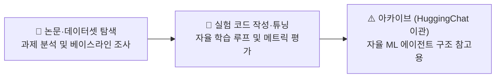

# ml-intern

> **[AI 에이전트 · 멀티에이전트 · 시각화 · 인프라](../README.md)** · 세부 장르: `AI 에이전트 / ML` · 상태: `보관`

논문 읽기·데이터셋 탐색·코드 작성·실험·배포까지 해주는 Hugging Face 자율 ML 엔지니어 에이전트.

## 언제 꺼내 쓰나 (적재적소 활용 시점)

- 보관 항목: 자율 ML 실험 에이전트 아키텍처 레퍼런스 참고용 (후속 기능은 HuggingChat 저장소로 통합됨)

## 한눈에 보는 작동 흐름 (Visual Workflow)

- **실행 형태:** 🗄️ 보관됨 (HuggingFace 자율 ML 레퍼런스)



| 구분 | 설명 |
| :--- | :--- |
| ❌ **기존 문제 (Before)** | 별도 유지보수 중단(아카이브)으로 현행 실행 비권장 |
| ✅ **스킬 적용 후 (After)** | 자율 ML 실험 에이전트 아키텍처 참고 자료로 보관 |

## 단계별 명령어 & 프롬프트 치트시트

### ① 구조 참고용 클론
- 아카이브된 저장소 코드 구조 열람
```text
powershell -File scripts\clone-skill.ps1 ml-intern
```

## 기본 정보

| 항목 | 내용 |
| :--- | :--- |
| **ID / 슬러그** | `#28` / `ml-intern` |
| **GitHub 저장소** | [huggingface/ml-intern](https://github.com/huggingface/ml-intern) |
| **빠른 링크** | [README](https://github.com/huggingface/ml-intern#readme) · [Issues](https://github.com/huggingface/ml-intern/issues) · [Releases](https://github.com/huggingface/ml-intern/releases) |
| **세부 장르** | AI 에이전트 / ML |
| **저장 당시 스타** | 미표기 |
| **주 언어 / 라이선스** | 미표기 / Apache-2.0 |
| **저장일 / 로컬 상태** | 2026-11-06 / 미클론 (경량 카드 모드) |
| **태그** | `#ml-intern` `#ML 에이전트` `#Hugging Face` `#아카이브됨` |

## 설치 및 활용 방법

- **가이드:** 아카이브됨. 구조 참고 시 저장소 클론 후 README 확인
- **원클릭 로컬 클론 (이 폴더 옆 `./repo`에 소스 다운로드):**
  ```powershell
  powershell -File ..\..\scripts\clone-skill.ps1 ml-intern
  ```
- **상태 변경:**
  ```powershell
  python ..\..\scripts\manage_skills.py status ml-intern "사용 중"
  ```

## 서재 메모 (Context & Caveats)

2026-10-25 @jisik.chanel '모르면 손해보는 오픈소스 9가지' 3번 — 저장소가 아카이브되어 더 이상 유지보수 안 함('ML Intern has now moved to the HuggingChat repo' 안내).

## 나의 실습 및 커스텀 노트 (User Notes)

- 여기에 직접 실행해본 설정값, 트러블슈팅, 커스텀 프롬프트 메모를 자유롭게 기록하세요.
