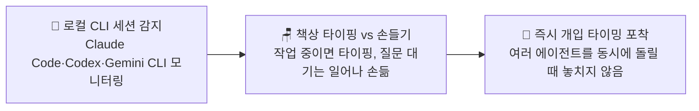

# whatsmyagentdoing

> **[AI 에이전트 · 멀티에이전트 · 시각화 · 인프라](../README.md)** · 세부 장르: `에이전트 시각화` · 상태: `보고 싶음`

로컬에서 돌아가는 Claude Code, Codex, Gemini CLI 등의 세션을 작은 오피스로 보여주는 스킬. 일하는 에이전트는 책상에 앉아 생각·타이핑하고, 도움이 필요하면 일어나서 손을 흔듦.

## 언제 꺼내 쓰나 (적재적소 활용 시점)

- 여러 로컬 CLI 에이전트(Claude Code, Codex, Gemini CLI)가 동시에 일하거나 사용자 입력을 기다리는 상태를 직관적인 미니 오피스로 한눈에 보고 싶을 때

## 한눈에 보는 작동 흐름 (Visual Workflow)

- **실행 형태:** 🏢 멀티 CLI 에이전트 오피스 시각화



| 구분 | 설명 |
| :--- | :--- |
| ❌ **기존 문제 (Before)** | 여러 터미널 탭을 띄워두면 어떤 에이전트가 입력 대기 중인지 일일이 확인해야 함 |
| ✅ **스킬 적용 후 (After)** | 도움이 필요한 에이전트가 자리에서 일어나 손을 흔들어 즉각 인지 가능 |

## 단계별 명령어 & 프롬프트 치트시트

### ① 저장소 클론
- Node 18+ 필요
```text
powershell -File scripts\clone-skill.ps1 whatsmyagentdoing
```

### ② 오피스 뷰 실행
- 로컬 오피스 시각화 대시보드 열기
```text
/myoffice
```

## 기본 정보

| 항목 | 내용 |
| :--- | :--- |
| **ID / 슬러그** | `#33` / `whatsmyagentdoing` |
| **GitHub 저장소** | [Charonyuu/whatsmyagentdoing](https://github.com/Charonyuu/whatsmyagentdoing) |
| **빠른 링크** | [README](https://github.com/Charonyuu/whatsmyagentdoing#readme) · [Issues](https://github.com/Charonyuu/whatsmyagentdoing/issues) · [Releases](https://github.com/Charonyuu/whatsmyagentdoing/releases) |
| **세부 장르** | 에이전트 시각화 |
| **저장 당시 스타** | ★ 377 |
| **주 언어 / 라이선스** | 미표기 / MIT |
| **저장일 / 로컬 상태** | 2026-11-06 / 미클론 (경량 카드 모드) |
| **태그** | `#whatsmyagentdoing` `#에이전트 시각화` `#오피스` |

## 설치 및 활용 방법

- **가이드:** Node 18+ 환경에서 저장소 클론 및 `/myoffice` 스킬 연동
- **원클릭 로컬 클론 (이 폴더 옆 `./repo`에 소스 다운로드):**
  ```powershell
  powershell -File ..\..\scripts\clone-skill.ps1 whatsmyagentdoing
  ```
- **상태 변경:**
  ```powershell
  python ..\..\scripts\manage_skills.py status whatsmyagentdoing "사용 중"
  ```

## 서재 메모 (Context & Caveats)

사용자가 2026-11-05 공유한 AI 에이전트 시각화 도구 글(@vibebusiness0928) 1번 — Node 18+, `/myoffice`.

## 나의 실습 및 커스텀 노트 (User Notes)

- 여기에 직접 실행해본 설정값, 트러블슈팅, 커스텀 프롬프트 메모를 자유롭게 기록하세요.
