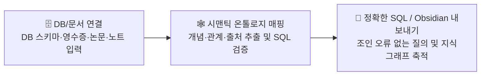

# auto-ontology-mcp

> **[MCP 서버 (Model Context Protocol)](../README.md)** · 세부 장르: `MCP / 데이터 · 지식베이스` · 상태: `보고 싶음`

NVIDIA Auto Ontology의 시맨틱 레이어를 Claude, ChatGPT 등 MCP 클라이언트용 MCP 서버로 가져온 프로젝트. LLM API 키 불필요. 데이터베이스 질문(온톨로지 기반 조인·SQL 검증) + 개인 지식베이스 유지(영수증·명세서·논문·책 노트를 사실·개념·출처와 함께 저장, Obsidian vault 내보내기) 기능 제공.

## 언제 꺼내 쓰나 (적재적소 활용 시점)

- 정확한 조인/SQL 검증이 필요한 Text-to-SQL DB 질의나 영수증·논문·노트를 온톨로지 지식 그래프로 구조화해 Obsidian vault와 연동하고 싶을 때

## 한눈에 보는 작동 흐름 (Visual Workflow)

- **실행 형태:** 🔌 온톨로지 DB·지식베이스 MCP 서버



| 구분 | 설명 |
| :--- | :--- |
| ❌ **기존 문제 (Before)** | Text-to-SQL 시 조인 키를 틀리거나 개인 문서·영수증이 흩어짐 |
| ✅ **스킬 적용 후 (After)** | 온톨로지 계층으로 SQL을 검증하고 Obsidian Vault로 지식 자동 정리 |

## 단계별 명령어 & 프롬프트 치트시트

### ① 저장소 클론
- 별도 LLM API 키 없이 MCP 클라이언트가 추론 담당
```text
powershell -File scripts\clone-skill.ps1 auto-ontology-mcp
```

### ② MCP 클라이언트 연결
- DB 질의 및 Obsidian 지식베이스 도구 활성화
```text
README 안내에 따라 mcp_config.json 에 auto-ontology-mcp 서버 등록
```

## 기본 정보

| 항목 | 내용 |
| :--- | :--- |
| **ID / 슬러그** | `#14` / `auto-ontology-mcp` |
| **GitHub 저장소** | [gogoymh/auto-ontology-mcp](https://github.com/gogoymh/auto-ontology-mcp) |
| **빠른 링크** | [README](https://github.com/gogoymh/auto-ontology-mcp#readme) · [Issues](https://github.com/gogoymh/auto-ontology-mcp/issues) · [Releases](https://github.com/gogoymh/auto-ontology-mcp/releases) |
| **세부 장르** | MCP / 데이터 · 지식베이스 |
| **저장 당시 스타** | ★ 18 |
| **주 언어 / 라이선스** | 미표기 / Apache-2.0 |
| **저장일 / 로컬 상태** | 2026-11-07 / 미클론 (경량 카드 모드) |
| **태그** | `#auto-ontology-mcp` `#MCP` `#온톨로지` `#text-to-SQL` `#지식베이스` `#NVIDIA` `#Obsidian` |

## 설치 및 활용 방법

- **가이드:** 저장소 클론 후 README 안내에 따라 Claude Desktop / Claude Code / MCP 클라이언트 설정 등록
- **원클릭 로컬 클론 (이 폴더 옆 `./repo`에 소스 다운로드):**
  ```powershell
  powershell -File ..\..\scripts\clone-skill.ps1 auto-ontology-mcp
  ```
- **상태 변경:**
  ```powershell
  python ..\..\scripts\manage_skills.py status auto-ontology-mcp "사용 중"
  ```

## 서재 메모 (Context & Caveats)

사용자가 2026-11-07 서재에 직접 추가 요청한 저장소. 언어 처리(읽기·추출·명명·판단·SQL 작성)를 MCP 클라이언트 쪽 LLM에 맡겨 별도 API 키가 필요 없음.

## 나의 실습 및 커스텀 노트 (User Notes)

- 여기에 직접 실행해본 설정값, 트러블슈팅, 커스텀 프롬프트 메모를 자유롭게 기록하세요.
