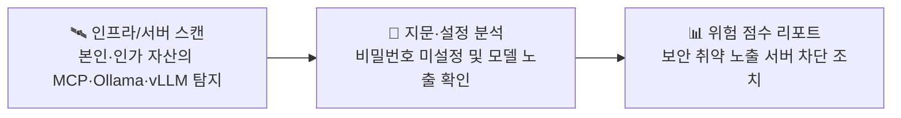

# AIMap

> **[AI 보안 감사 & OSINT](../README.md)** · 세부 장르: `AI 보안` · 상태: `보고 싶음`

인터넷에 비밀번호 없이 노출된 AI 서버(MCP·Ollama·vLLM 등)를 Shodan으로 찾아 지문·위험 점수·보안 테스트를 하는 플랫폼.

## 언제 꺼내 쓰나 (적재적소 활용 시점)

- 본인이 운영하거나 인가받은 인프라에서 MCP, Ollama, vLLM 등 AI 서버가 인증 없이 외부에 노출되지 않았는지 보안 점검할 때

## 한눈에 보는 작동 흐름 (Visual Workflow)

- **실행 형태:** 🛡️ 노출 AI 서버 보안 점검 플랫폼



| 구분 | 설명 |
| :--- | :--- |
| ❌ **기존 문제 (Before)** | 로컬·클라우드에서 띄운 Ollama/MCP 포트가 인증 없이 외부에 열려있는지 모름 |
| ✅ **스킬 적용 후 (After)** | 노출된 AI 엔드포인트를 지문 분석·점수화해 즉시 잠금 조치 |

## 단계별 명령어 & 프롬프트 치트시트

### ① 저장소 클론
- BishopFox 공식 저장소 다운로드 (본인/인가 서버 전용)
```text
powershell -File scripts\clone-skill.ps1 aimap
```

### ② 점검 실행
- 허가된 본인 자산 점검용으로만 활용
```text
AIMap README 기준으로 내가 운영하는 서버의 Ollama/MCP 노출 여부를 점검하는 방법을 알려줘
```

## 기본 정보

| 항목 | 내용 |
| :--- | :--- |
| **ID / 슬러그** | `#18` / `aimap` |
| **GitHub 저장소** | [BishopFox/aimap](https://github.com/BishopFox/aimap) |
| **빠른 링크** | [README](https://github.com/BishopFox/aimap#readme) · [Issues](https://github.com/BishopFox/aimap/issues) · [Releases](https://github.com/BishopFox/aimap/releases) |
| **세부 장르** | AI 보안 |
| **저장 당시 스타** | 미표기 |
| **주 언어 / 라이선스** | 미표기 / MIT |
| **저장일 / 로컬 상태** | 2026-11-06 / 미클론 (경량 카드 모드) |
| **태그** | `#AIMap` `#AI 서버 보안` `#Shodan` `#MCP` `#Ollama` |

## 설치 및 활용 방법

- **가이드:** 저장소 클론 후 README 참고 (인가된 본인 소유 서버 점검 목적에 한해 사용)
- **원클릭 로컬 클론 (이 폴더 옆 `./repo`에 소스 다운로드):**
  ```powershell
  powershell -File ..\..\scripts\clone-skill.ps1 aimap
  ```
- **상태 변경:**
  ```powershell
  python ..\..\scripts\manage_skills.py status aimap "사용 중"
  ```

## 서재 메모 (Context & Caveats)

2026-10-28 @ai.yeongseon AI 보안 도구 소개글 2번 — 본인 소유·허가받은 대상 서버 점검 전용. 동명의 `nuclide-research/aimap`과는 다른 프로젝트.

## 나의 실습 및 커스텀 노트 (User Notes)

- 여기에 직접 실행해본 설정값, 트러블슈팅, 커스텀 프롬프트 메모를 자유롭게 기록하세요.
