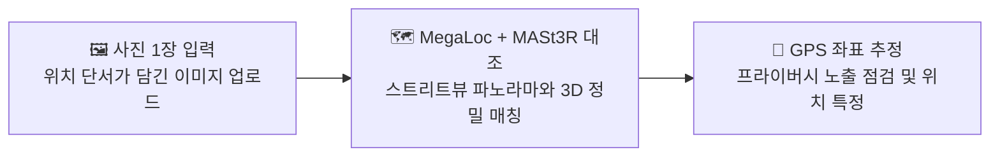

# Netryx (Astra V2)

> **[AI 보안 감사 & OSINT](../README.md)** · 세부 장르: `AI 보안 / OSINT` · 상태: `보고 싶음`

사진 한 장을 스트리트뷰 파노라마와 대조해 정확한 GPS 좌표로 추적하는 로컬 우선 OSINT 지오로케이션 도구 (MegaLoc+MASt3R 파이프라인).

## 언제 꺼내 쓰나 (적재적소 활용 시점)

- 공개 사진에 민감한 위치 정보(프라이버시 노출 여부)가 특정될 수 있는지 로컬 AI 지오로케이션으로 점검하거나 OSINT 위치 검증이 필요할 때

## 한눈에 보는 작동 흐름 (Visual Workflow)

- **실행 형태:** 📍 로컬 AI 지오로케이션 OSINT 도구



| 구분 | 설명 |
| :--- | :--- |
| ❌ **기존 문제 (Before)** | SNS에 올린 사진에 집/직장 주변 위치 단서가 노출되는지 알기 어려움 |
| ✅ **스킬 적용 후 (After)** | 로컬 파이프라인으로 사진 속 위치를 추적해 보안/프라이버시 노출 점검 |

## 단계별 명령어 & 프롬프트 치트시트

### ① 저장소 클론
- Astra V2 최신 저장소 다운로드
```text
powershell -File scripts\clone-skill.ps1 netryx-astra-v2
```

### ② 파이프라인 구성
- 정당한 본인 정보 노출 점검/OSINT 연구에 사용
```text
Netryx Astra V2 README 기준으로 실행 환경과 GPU 요구사항을 확인해줘
```

## 기본 정보

| 항목 | 내용 |
| :--- | :--- |
| **ID / 슬러그** | `#22` / `netryx-astra-v2` |
| **GitHub 저장소** | [sparkyniner/Netryx-Astra-V2-Geolocation-Tool](https://github.com/sparkyniner/Netryx-Astra-V2-Geolocation-Tool) |
| **빠른 링크** | [README](https://github.com/sparkyniner/Netryx-Astra-V2-Geolocation-Tool#readme) · [Issues](https://github.com/sparkyniner/Netryx-Astra-V2-Geolocation-Tool/issues) · [Releases](https://github.com/sparkyniner/Netryx-Astra-V2-Geolocation-Tool/releases) |
| **세부 장르** | AI 보안 / OSINT |
| **저장 당시 스타** | 미표기 |
| **주 언어 / 라이선스** | 미표기 / MIT |
| **저장일 / 로컬 상태** | 2026-11-06 / 미클론 (경량 카드 모드) |
| **태그** | `#Netryx` `#지오로케이션` `#OSINT` `#AI 보안` |

## 설치 및 활용 방법

- **가이드:** 저장소 클론 후 MegaLoc+MASt3R 의존성 설치(README 참고)
- **원클릭 로컬 클론 (이 폴더 옆 `./repo`에 소스 다운로드):**
  ```powershell
  powershell -File ..\..\scripts\clone-skill.ps1 netryx-astra-v2
  ```
- **상태 변경:**
  ```powershell
  python ..\..\scripts\manage_skills.py status netryx-astra-v2 "사용 중"
  ```

## 서재 메모 (Context & Caveats)

2026-10-28 @ai.yeongseon AI 보안 도구 소개글 1번 — 본인 정보 노출 점검 등 정당한 보안 연구/테스트 용도로만 활용.

## 나의 실습 및 커스텀 노트 (User Notes)

- 여기에 직접 실행해본 설정값, 트러블슈팅, 커스텀 프롬프트 메모를 자유롭게 기록하세요.
