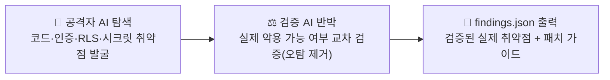

# security-audit-skill

> **[AI 보안 감사 & OSINT](../README.md)** · 세부 장르: `AI 보안` · 상태: `보고 싶음`

코딩 에이전트를 6단계 보안 감사관으로 바꾸는 Cloudflare 스킬. 구멍을 찾는 AI와 그걸 반박하는 AI가 따로 일해 검증된 결과만 `findings.json`으로 정리한다.

## 언제 꺼내 쓰나 (적재적소 활용 시점)

- 바이브코딩이나 AI로 만든 웹/앱 서비스를 실제 인터넷에 배포하기 전에 오탐을 걸러낸 정밀 6단계 보안 감사(`findings.json`)를 수행하고 싶을 때

## 한눈에 보는 작동 흐름 (Visual Workflow)

- **실행 형태:** 🛡️ 6단계 보안 감사 에이전트 스킬



| 구분 | 설명 |
| :--- | :--- |
| ❌ **기존 문제 (Before)** | 바이브코딩 앱에 API 키 노출·인증 우회·DB 공개 위험이 있는 채로 배포 |
| ✅ **스킬 적용 후 (After)** | 탐색 AI와 반박 AI가 6단계로 교차 검증한 진짜 보안 취약점만 보고 |

## 단계별 명령어 & 프롬프트 치트시트

### ① 저장소 클론
- Cloudflare 보안 감사 스킬 로컬 다운로드
```text
powershell -File scripts\clone-skill.ps1 security-audit-skill
```

### ② 배포 전 감사 실행
- 배포 직전 취약점 전수 검사 및 수정안 도출
```text
security-audit-skill 절차로 이 프로젝트 전체를 6단계 보안 감사하고 findings.json을 만들어줘
```

## 세부 스킬 / 파이프라인 단계 (6종)

| 이름 | 단계 | 작동 흐름 | 호출 명령 / 프롬프트 | 설명 |
| :--- | :---: | :--- | :--- | :--- |
| **1단계: 공격 표면 매핑** | `탐색` | 코드 스캔 → 진입점 목록화 | `엔드포인트·인증·외부 연동 식별` | API 라우트, 인증 미들웨어, DB 접근 경로 파악 |
| **2단계: 시크릿 & 설정 점검** | `탐색` | 환경변수/설정 검사 → 노출 위험 탐지 | `하드코딩 키·CORS·헤더 감사` | 클라이언트 번들에 비밀키가 섞였는지 점검 |
| **3단계: 취약점 가설 수립** | `탐색` | 데이터 흐름 추적 → 공격 시나리오 작성 | `SQLi·XSS·IDOR·권한 상승 탐색` | 데이터 입력부터 DB 실행까지 오염 경로 분석 |
| **4단계: 반박 검증 (Red vs Blue)** | `검증` | 방어 코드 확인 → 오탐 필터링 | `가설별 실제 악용 가능성 반증 시도` | 단순 패턴 매칭 오탐을 반박 AI가 걸러냄 |
| **5단계: 심각도 산정** | `정리` | Critical~Low 등급 분류 | `CVSS 기준 영향도·재현 난이도 평가` | 우선 수정해야 할 핵심 취약점 순위화 |
| **6단계: findings.json 생성** | `출력` | 구조화 JSON 리포트 생성 | `재현 경로 + 구체적 패치 코드 출력` | 바로 수정 작업에 투입할 수 있는 리포트 생성 |

## 기본 정보

| 항목 | 내용 |
| :--- | :--- |
| **ID / 슬러그** | `#3` / `security-audit-skill` |
| **GitHub 저장소** | [cloudflare/security-audit-skill](https://github.com/cloudflare/security-audit-skill) |
| **빠른 링크** | [README](https://github.com/cloudflare/security-audit-skill#readme) · [Issues](https://github.com/cloudflare/security-audit-skill/issues) · [Releases](https://github.com/cloudflare/security-audit-skill/releases) |
| **세부 장르** | AI 보안 |
| **저장 당시 스타** | ★ 74,901 |
| **주 언어 / 라이선스** | 미표기 / MIT |
| **저장일 / 로컬 상태** | 2026-11-18 / 미클론 (경량 카드 모드) |
| **태그** | `#Claude Code` `#보안 감사` `#바이브코딩` `#Cloudflare` |

## 설치 및 활용 방법

- **가이드:** 저장소 클론 후 스킬 폴더(`.claude/skills` 등) 또는 README 안내에 따라 코딩 에이전트에 장착
- **원클릭 로컬 클론 (이 폴더 옆 `./repo`에 소스 다운로드):**
  ```powershell
  powershell -File ..\..\scripts\clone-skill.ps1 security-audit-skill
  ```
- **상태 변경:**
  ```powershell
  python ..\..\scripts\manage_skills.py status security-audit-skill "사용 중"
  ```

## 서재 메모 (Context & Caveats)

사용자가 2026-11-18 공유한 릴로 확인(@withbeno 릴, 2026-10-23). 바이브코딩으로 만든 앱을 인터넷에 올리기 전 보안 감사 용도.

## 나의 실습 및 커스텀 노트 (User Notes)

- 여기에 직접 실행해본 설정값, 트러블슈팅, 커스텀 프롬프트 메모를 자유롭게 기록하세요.
