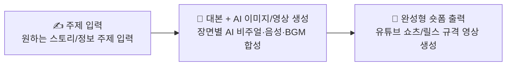

# Pixelle-Video

> **[영상 생성 · 편집 · 화면 녹화](../README.md)** · 세부 장르: `영상 생성 / AI 비디오` · 상태: `보고 싶음`

주제만 입력하면 대본·AI 이미지/영상·음성·BGM까지 자동 생성해 숏폼을 완성하는 도구.

## 언제 꺼내 쓰나 (적재적소 활용 시점)

- 스톡 영상 대신 AI 생성 이미지/비디오·TTS·BGM을 조합해 주제만으로 완성형 숏폼 영상을 자동 생성하고 싶을 때

## 한눈에 보는 작동 흐름 (Visual Workflow)

- **실행 형태:** 🎬 AI 이미지/비디오 기반 숏폼 생성기



| 구분 | 설명 |
| :--- | :--- |
| ❌ **기존 문제 (Before)** | 기존 스톡 영상 위주 생성기는 내용과 100% 맞는 장면 연출이 어려움 |
| ✅ **스킬 적용 후 (After)** | AI 이미지/비디오 생성 파이프라인으로 대본에 딱 맞는 비주얼 숏폼 제작 |

## 단계별 명령어 & 프롬프트 치트시트

### ① 저장소 클론
- ATH-MaaS/Pixelle-Video 최신 주소로 다운로드
```text
powershell -File scripts\clone-skill.ps1 pixelle-video
```

### ② 실행 세팅
- 영상 자동 생성 파이프라인 구축
```text
Pixelle-Video README 기준으로 필요한 API 키와 로컬 실행 방법을 정리해줘
```

## 기본 정보

| 항목 | 내용 |
| :--- | :--- |
| **ID / 슬러그** | `#29` / `pixelle-video` |
| **GitHub 저장소** | [ATH-MaaS/Pixelle-Video](https://github.com/ATH-MaaS/Pixelle-Video) |
| **빠른 링크** | [README](https://github.com/ATH-MaaS/Pixelle-Video#readme) · [Issues](https://github.com/ATH-MaaS/Pixelle-Video/issues) · [Releases](https://github.com/ATH-MaaS/Pixelle-Video/releases) |
| **세부 장르** | 영상 생성 / AI 비디오 |
| **저장 당시 스타** | 미표기 |
| **주 언어 / 라이선스** | 미표기 / Apache-2.0 |
| **저장일 / 로컬 상태** | 2026-11-06 / 미클론 (경량 카드 모드) |
| **태그** | `#Pixelle-Video` `#숏폼` `#영상 자동 생성` `#AI 비디오` |

## 설치 및 활용 방법

- **가이드:** 저장소 클론 후 README 설치 가이드 참고
- **원클릭 로컬 클론 (이 폴더 옆 `./repo`에 소스 다운로드):**
  ```powershell
  powershell -File ..\..\scripts\clone-skill.ps1 pixelle-video
  ```
- **상태 변경:**
  ```powershell
  python ..\..\scripts\manage_skills.py status pixelle-video "사용 중"
  ```

## 서재 메모 (Context & Caveats)

2026-10-25 @jisik.chanel '모르면 손해보는 오픈소스 9가지' 1번 — 조직명이 AIDC-AI에서 ATH-MaaS로 변경됨.

## 나의 실습 및 커스텀 노트 (User Notes)

- 여기에 직접 실행해본 설정값, 트러블슈팅, 커스텀 프롬프트 메모를 자유롭게 기록하세요.
