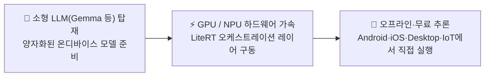

# LiteRT-LM

> **[앱 빌더 · 바이브코딩 · 코드 시각화 · 로컬 AI](../README.md)** · 세부 장르: `온디바이스 AI` · 상태: `보고 싶음`

Google의 온디바이스 LLM 실행 오케스트레이션 레이어. Gemma 등 소형 모델을 Android/iOS/데스크톱/IoT에서 GPU/NPU 가속으로 실행.

## 언제 꺼내 쓰나 (적재적소 활용 시점)

- 클라우드 비용이나 네트워크 없이 모바일·데스크톱·엣지 기기에서 Gemma 등 경량 LLM을 GPU/NPU 가속으로 직접 구동하는 앱을 개발할 때

## 한눈에 보는 작동 흐름 (Visual Workflow)

- **실행 형태:** 📱 Google 온디바이스 LLM 런타임



| 구분 | 설명 |
| :--- | :--- |
| ❌ **기존 문제 (Before)** | 작은 기능 하나에도 매번 클라우드 LLM API 과금과 네트워크 지연 발생 |
| ✅ **스킬 적용 후 (After)** | 사용자 기기의 GPU/NPU에서 오프라인으로 빠르게 소형 LLM 직접 실행 |

## 단계별 명령어 & 프롬프트 치트시트

### ① 저장소 클론
- google-ai-edge/LiteRT-LM 다운로드
```text
powershell -File scripts\clone-skill.ps1 litert-lm
```

### ② 플랫폼 연동
- 온디바이스 AI 앱 개발 시 활용
```text
LiteRT-LM으로 Windows 또는 Android 앱에 Gemma 모델을 온디바이스로 붙이는 방법을 안내해줘
```

## 기본 정보

| 항목 | 내용 |
| :--- | :--- |
| **ID / 슬러그** | `#26` / `litert-lm` |
| **GitHub 저장소** | [google-ai-edge/LiteRT-LM](https://github.com/google-ai-edge/LiteRT-LM) |
| **빠른 링크** | [README](https://github.com/google-ai-edge/LiteRT-LM#readme) · [Issues](https://github.com/google-ai-edge/LiteRT-LM/issues) · [Releases](https://github.com/google-ai-edge/LiteRT-LM/releases) |
| **세부 장르** | 온디바이스 AI |
| **저장 당시 스타** | 미표기 |
| **주 언어 / 라이선스** | 미표기 / Apache-2.0 |
| **저장일 / 로컬 상태** | 2026-11-06 / 미클론 (경량 카드 모드) |
| **태그** | `#LiteRT-LM` `#온디바이스 LLM` `#Gemma` `#Google` |

## 설치 및 활용 방법

- **가이드:** 저장소 클론 후 플랫폼별(Android/iOS/Desktop) 빌드 및 런타임 가이드 참고
- **원클릭 로컬 클론 (이 폴더 옆 `./repo`에 소스 다운로드):**
  ```powershell
  powershell -File ..\..\scripts\clone-skill.ps1 litert-lm
  ```
- **상태 변경:**
  ```powershell
  python ..\..\scripts\manage_skills.py status litert-lm "사용 중"
  ```

## 서재 메모 (Context & Caveats)

2026-10-25 @jisik.chanel '모르면 손해보는 오픈소스 9가지' 6번.

## 나의 실습 및 커스텀 노트 (User Notes)

- 여기에 직접 실행해본 설정값, 트러블슈팅, 커스텀 프롬프트 메모를 자유롭게 기록하세요.
