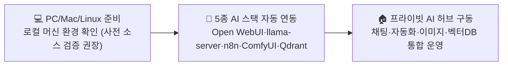

# ODS (Osmantic Deployment System)

> **[앱 빌더 · 바이브코딩 · 코드 시각화 · 로컬 AI](../README.md)** · 세부 장르: `로컬 AI 서버` · 상태: `보고 싶음`

PC/Mac/Linux를 로컬 AI 서버로 바꾸는 스택 설치기. Open WebUI·llama-server·n8n·ComfyUI·Qdrant 등 미리 연결.

## 언제 꺼내 쓰나 (적재적소 활용 시점)

- Open WebUI, llama-server, n8n, ComfyUI, Qdrant가 한 번에 연결된 로컬 AI 서버 스택 구성 스크립트를 참고하거나 구축하고 싶을 때 (소스 사전 검토 권장)

## 한눈에 보는 작동 흐름 (Visual Workflow)

- **실행 형태:** 🐳 올인원 로컬 AI 서버 스택 설치기



| 구분 | 설명 |
| :--- | :--- |
| ❌ **기존 문제 (Before)** | Open WebUI, n8n, ComfyUI, 벡터DB를 각각 설치하고 포트를 일일이 연결 |
| ✅ **스킬 적용 후 (After)** | 미리 연결된 통합 스택 구성 참고 (단, 스타 수·라이선스 혼재 이슈로 스크립트 사전 검토 필수) |

## 단계별 명령어 & 프롬프트 치트시트

### ① 클론 후 소스 검토
- 주의: 홍보 수치와 실제 저장소 차이가 있어 실행 전 스크립트 검토 필수
```text
powershell -File scripts\clone-skill.ps1 ods
```

### ② Docker 구성 확인
- 로컬 AI 스택 아키텍처 참고
```text
ods 저장소 안의 docker-compose 및 설치 스크립트를 분석해서 안전한 부분만 설명해줘
```

## 기본 정보

| 항목 | 내용 |
| :--- | :--- |
| **ID / 슬러그** | `#41` / `ods` |
| **GitHub 저장소** | [osmantic-ods/ods](https://github.com/osmantic-ods/ods) |
| **빠른 링크** | [README](https://github.com/osmantic-ods/ods#readme) · [Issues](https://github.com/osmantic-ods/ods/issues) · [Releases](https://github.com/osmantic-ods/ods/releases) |
| **세부 장르** | 로컬 AI 서버 |
| **저장 당시 스타** | ★ 6 |
| **주 언어 / 라이선스** | 미표기 / 혼재 (Apache-2.0 배지 / MIT LICENSE 표기) |
| **저장일 / 로컬 상태** | 2026-11-06 / 미클론 (경량 카드 모드) |
| **태그** | `#ODS` `#로컬 AI 서버` `#Open WebUI` `#n8n` `#ComfyUI` |

## 설치 및 활용 방법

- **가이드:** 저장소 클론 후 설치 스크립트 및 Docker 구성 사전 검토 후 실행
- **원클릭 로컬 클론 (이 폴더 옆 `./repo`에 소스 다운로드):**
  ```powershell
  powershell -File ..\..\scripts\clone-skill.ps1 ods
  ```
- **상태 변경:**
  ```powershell
  python ..\..\scripts\manage_skills.py status ods "사용 중"
  ```

## 서재 메모 (Context & Caveats)

사용자가 2026-10-15 공유한 관심 프로젝트 — 홍보 이미지 수치와 실제 저장소 스타 수(6개)·라이선스 표기 불일치로 사용 전 소스 검증 권장.

## 나의 실습 및 커스텀 노트 (User Notes)

- 여기에 직접 실행해본 설정값, 트러블슈팅, 커스텀 프롬프트 메모를 자유롭게 기록하세요.
