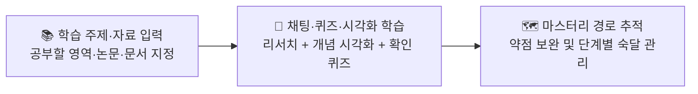

# DeepTutor

> **[도메인 특화 (교육 · 금융) & 오픈소스 모음](../README.md)** · 세부 장르: `교육 / AI 튜터` · 상태: `보고 싶음`

채팅 튜터링·퀴즈·리서치·시각화·마스터리 경로를 한 앱에 모은 에이전트 네이티브 평생 개인 튜터링 워크스페이스.

## 언제 꺼내 쓰나 (적재적소 활용 시점)

- 새로운 기술·학문을 체계적인 커리큘럼, 퀴즈, 시각화, 심화 리서치와 함께 AI 튜터에게 학습하고 싶을 때

## 한눈에 보는 작동 흐름 (Visual Workflow)

- **실행 형태:** 🎓 에이전트 네이티브 개인 AI 튜터



| 구분 | 설명 |
| :--- | :--- |
| ❌ **기존 문제 (Before)** | 일반 챗봇에게 질문하면 맥락이 쌓이지 않고 퀴즈·진도 관리가 안 됨 |
| ✅ **스킬 적용 후 (After)** | 채팅·퀴즈·시각화·리서치가 하나로 통합된 평생 개인 튜터 워크스페이스 |

## 단계별 명령어 & 프롬프트 치트시트

### ① 저장소 클론
- HKUDS/DeepTutor 로컬 다운로드
```text
powershell -File scripts\clone-skill.ps1 deeptutor
```

### ② 워크스페이스 실행
- 개인 학습 대시보드 실행
```text
DeepTutor README에 맞춰 로컬 실행 환경을 구성하고 구동해줘
```

## 기본 정보

| 항목 | 내용 |
| :--- | :--- |
| **ID / 슬러그** | `#20` / `deeptutor` |
| **GitHub 저장소** | [HKUDS/DeepTutor](https://github.com/HKUDS/DeepTutor) |
| **빠른 링크** | [README](https://github.com/HKUDS/DeepTutor#readme) · [Issues](https://github.com/HKUDS/DeepTutor/issues) · [Releases](https://github.com/HKUDS/DeepTutor/releases) |
| **세부 장르** | 교육 / AI 튜터 |
| **저장 당시 스타** | 미표기 |
| **주 언어 / 라이선스** | 미표기 / Apache-2.0 |
| **저장일 / 로컬 상태** | 2026-11-06 / 미클론 (경량 카드 모드) |
| **태그** | `#DeepTutor` `#AI 튜터` `#교육` |

## 설치 및 활용 방법

- **가이드:** 저장소 클론 후 README의 설치 및 실행 명령어 참고
- **원클릭 로컬 클론 (이 폴더 옆 `./repo`에 소스 다운로드):**
  ```powershell
  powershell -File ..\..\scripts\clone-skill.ps1 deeptutor
  ```
- **상태 변경:**
  ```powershell
  python ..\..\scripts\manage_skills.py status deeptutor "사용 중"
  ```

## 서재 메모 (Context & Caveats)

2026-10-25 @jisik.chanel '모르면 손해보는 오픈소스 9가지' 9번.

## 나의 실습 및 커스텀 노트 (User Notes)

- 여기에 직접 실행해본 설정값, 트러블슈팅, 커스텀 프롬프트 메모를 자유롭게 기록하세요.
